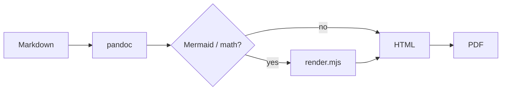

<div class="doc executive"></div>

# Markdown Examples
Paired raw → rendered examples

----

# Markdown: raw-before-rendered examples


## Alerts

GitHub alerts: exactly five types (NOTE, TIP, IMPORTANT, WARNING, CAUTION),
rendered by GitHub, nvim (render-markdown) and pandoc `-f gfm` without a filter.
Any other `[!TAG]` stays a plain blockquote.


> [!NOTE]
> NOTE on a very long line still going 1233456788 abcdedfghighklmonopyerstuvwxyz
>
> `~/.config/markdown_generator/friendly_document_styling.css`


> [!TIP]
> TIP on a very long line still going 1233456788 abcdedfghighklmonopyerstuvwxyz


> [!IMPORTANT]
> IMPORTANT: key information needed to succeed.


> [!WARNING]
> WARNING on a very long line still going 1233456788
>
> A blank `>` line starts a new paragraph; a plain newline joins lines.


> [!CAUTION]
> CAUTION I wanted two lines.
> But this renders on one line.
>
> But this renders on a new line.


----


## Bash


```bash
mapfile -t brew_list < <(brew list --cask && brew list --installed-on-request)
for b in "${brew_list[@]}"; do
    echo "$b" >>.brew_install_list.txt
done
```

----

## Python


```python
if 5 > 2:
    print("Five is greater than two!")
```

----

## Lua


```lua
local dirs = { vim.fn.stdpath('config') }
for _, p in ipairs(parts) do
    if p:match("%S") then table.insert(dirs, p) end
end
return dirs
```

----

## cpp 


```cpp
#include <iostream>
int main(){ std::cout << "hello"; }
```

----

## Log block

```log
[WARN] example warning
[ERROR] example error
[WARN] example warning
[ERROR] example error
[WARN] example warning
[ERROR] example error
[WARN] example warning
[ERROR] example error
```

----

## File block


```file
/path/to/some/file.txt
~/.config/markdown_generator/friendly_document_styling.css
```

----

## Image


----

## Table


| Column1 | Column2 | Column3 |
| ------- | ------- | ------- |
| Item1.1 | Item2.1 | Item3.1 |
| Item1.2 | Item2.2 | Item3.2 |

----

## Nested list

- header_level_one
    - header_level_two
        - header_level_three


### Numbered list

1. first
2. second
3. third


----

## Inline code, links & plain quotes

Here is `inline code` rendered as a chip, next to [a link to pandoc.org](https://pandoc.org)
and ordinary text.

> A plain blockquote without a `[!NOTE]`-style first line keeps standard markdown
> styling: muted text behind a soft blue left bar.

----


## Example: Headers (H1 / H2 / H3)

# Example Header One

## Example Header Two

### Example Header Three

----

## The build pipeline (`<leader>mdo`)

`EXTERNAL_BUILD_AND_OPEN_PDF SRC.md OUT` (`~/.dotfiles/bash/external.sh`) writes
`OUT.html` (self-contained: images embedded, safe to send), `OUT.pdf` and
`OUT.png` next to the markdown:

```text
pandoc -f gfm+definition_lists+fenced_divs+attributes+implicit_figures
  → document.lua   front matter, title, TOC, numbering, code labels, task lists,
                   ::: callouts, csv/svg fences, page breaks
  → render.lua     ```dot ```d2 ```mermaid and $math$ → SVG (cached)
  → .html (screen.css / screen.js: copy buttons, # permalinks)
  → weasyprint .pdf → pdftoppm .png (background)
```

nvim: `<leader>mdo` build + open HTML · `<leader>mdp` build + open PDF ·
`<leader>mdw` rebuild on every `:w` (winbar `○ live` / `● live`; Cmd+R the
browser) · `<leader>mds` pick a style · `<leader>mdi` insert a snippet.
Warnings (missing image, bad mermaid / math) arrive as a WARN notification
even when the build succeeds. `MDGEN_OPEN=html|pdf|none` picks what opens when
run from a shell.

> [!NOTE]
> `--include-in-header` / `--include-after-body` insert files VERBATIM, so the
> CSS files carry their own `<style>` wrapper and `screen.js` its own
> `<script>`. pandoc's own default CSS is off (`-M document-css=false`; `-V`
> does NOT work): every rule is in `friendly_document_styling.css`.

## Front matter = build options

```yaml
---
title: Q3 Platform Review     # becomes the title if the body has no `# Title`
subtitle: For Leadership      # (else "author · date") → the subtitle line
theme: tokyo-night            # same as <div class="doc tokyo-night">
footer: Confidential          # PDF footer (left); "Page n of N" on the right
clean: true                   # copy-friendly PDF: no icon-font glyphs
toc: true                     # contents box (PDF: with page numbers); or a depth 2 / 3
numbered: true                # 1 / 1.1 / 1.1.1 headings (TOC too)
paper: a4                     # default letter; also "a4 landscape"
---
```

Snippets: `markdown_frontmatter_doc` (every option) and `markdown_doc_report`
(a whole report). `<leader>mds` edits `theme:` when there is front matter.

## Mermaid and math



Inline $E = mc^2$, or a display block:

$$
\sum_{k=1}^{n} k = \frac{n(n+1)}{2}
$$

Both run in ONE node process per build (`markdown_generator/render.mjs`):
MathJax for TeX, mermaid-cli + headless Chrome for diagrams, with the
"classic" look and SVG-text labels because weasyprint can't draw
`<foreignObject>`. Colors follow the document's theme, like dot / d2. The
node packages (~500MB) live OUTSIDE the dotfiles in
`~/.local/share/markdown_generator`, installed on first use by
`EXTERNAL_MARKDOWN_NODE_SETUP` (re-runs when `markdown_generator/package.json`
changes; uses Google Chrome.app instead of downloading Chromium). A bad diagram
is a red box with mermaid's message. Prices like $5 and $10 stay text.
Snippets: `markdown_mermaid_*` (flowchart, sequence, state, er, class, gantt,
pie, mindmap, timeline), `markdown_math_inline`, `_math_block`, `_math_aligned`.

## Report building blocks

::: tldr
Lead with the conclusion: `::: tldr` / `::: summary`.
:::

::: stats
- **38%** p95 latency
- **99.97%** uptime
- **12** services
:::

::: {.risk title="Custom title"}
Any callout or alert as a fenced div: `::: risk`, `::: warning`,
`::: {.decision title="…"}`.
:::

```csv
Block,Syntax
Metric tiles,::: stats + a bullet list of **number** label
Two columns,:::: columns / ::: column
Captioned image,{width=60%}
CSV table,```csv fence (first row = header)
Page break,::: pagebreak or \newpage
```

- [x] Task lists are drawn boxes (weasyprint can't draw checkboxes)
- [ ] Every code fence gets an icon + language label (nvim-web-devicons glyphs)

Term
: Definition lists work too.

## Document templates (one marker restyles everything)

Front matter `theme: NAME`, or one line anywhere in the markdown (nvim snippets
`markdown_doc_tokyo_night`, `_paper`, … one per template):

```html
<div class="doc tokyo-night" data-foot="Confidential"></div>
```

- `# Title` = page-1 title and the running header on pages 2+; the paragraph
  right under it = subtitle (header, right). `data-foot` / `footer:` = footer
  text; the footer's right side is "Page n of N".
- No marker = the plain style. Templates live ONLY in
  `markdown_generator/friendly_document_styling.css` (palette vars `--p-*`,
  `--t-*`, `:root:has(.name)`). New template = copy a `:root:has(.name) { … }`
  palette block; `<leader>mds` and render.lua pick it up automatically.

Templates: `tokyo-night` `paper` `executive` `terminal`, plus researched
palettes (official hex values) `catppuccin-mocha` `catppuccin-latte` `dracula`
`nord` `gruvbox-dark` `gruvbox-light` `solarized-dark` `solarized-light`
`rose-pine` `rose-pine-dawn`.

## Developer callouts, badges and the insert picker

Callouts (`::: KIND`, or `<div class="callout KIND">`, a blank line, markdown,
a blank line, `</div>`): `summary` `tldr` `decision` `risk` `breaking`
`deprecated` `action` `example` `question` `rollback` `perf`. The label is
drawn by the CSS (override with `{title="…"}`) — don't repeat it in the text.
Badges: `<span class="badge ok">Shipped</span>` (`ok warn bad info muted
accent`). ` ```diff ` colors removed / added / hunk lines.

nvim insert picker (`nvim/lua/user/snippet_picker.lua`): `<leader>mdi` or
`:Insert` — fuzzy search over every snippet, grouped by `category`, with a
preview. Type `3x4` for a table (3 body rows x 4 columns), `clipboard` to turn
copied CSV / TSV into a table. Skeleton snippets: `markdown_doc_report`,
`_adr`, `_postmortem`, `_runbook`, `_pr`, `_status`, `_professional`, plus
`markdown_api_endpoint`, `markdown_changelog_entry`.

## Diagrams (Graphviz, D2, Mermaid)

` ```dot ` / ` ```graphviz ` (Graphviz), ` ```d2 ` and ` ```mermaid ` fences
become diagrams coloured from the document's style (no style = the plain
palette). Filter: `markdown_generator/render.lua`. Needs `brew install graphviz
d2` (mermaid: see above). Don't write colors in the diagram — write nodes and
edges only. A syntax error renders as a red box with the tool's message and
your own line number. Snippets (category Diagrams): `markdown_dot_*`,
`markdown_d2_*`, `markdown_mermaid_*`. Cached by content in
`~/.cache/markdown_generator` (bump `VERSION` in render.lua after changing its
output).

## Copy buttons and permalinks (screen only)

`screen.js` wraps each `<pre>` in `<div class="codeblock">` (`display: flex`)
with the copy button as a sibling on the left — never an overlay, so the code
stays selectable. Hovering an h2–h6 shows a `#` permalink; Cmd+P opens every
`<details>` first. weasyprint runs no JS, so the PDF is unaffected.

> [!TIP]
> - The clipboard API needs a real user gesture: programmatic `.click()`
>   silently hangs; a real mouse click works (`execCommand("copy")` fallback).
> - Firefox gotcha: `open file.html` reuses the existing tab WITHOUT
>   reloading - after regenerating HTML you must Cmd+R to see changes.
